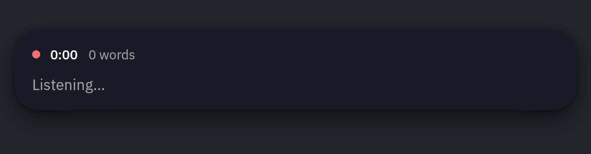

# earwig

Local dictation for Linux. Hold a key and talk, or tap it to keep listening.
You see the words as you speak, and when you stop they land wherever you're
typing, all at once.



If the overlay is in the way, drag it aside; the next dictation brings it
back.

## Setup

On NixOS:

```nix
imports = [ inputs.earwig.nixosModules.default ];

services.earwig.enable = true;
```

Elsewhere, `nix profile install github:adeci/earwig` and start `earwig daemon`
with your session.

## Hotkey

On GNOME and KDE, earwig asks to register Ctrl+Space when it first starts.

On niri, sway, Hyprland and COSMIC, bind it in your compositor. For niri:

```kdl
Ctrl+Space {
    press { spawn "earwig" "press"; }
    release { spawn "earwig" "release"; }
}
```

Elsewhere, run `earwig press` on key down and `earwig release` on key up, or
`earwig toggle` if your compositor can't bind key releases. `earwig cancel`
discards a recording.

## Models

Pick a model in the settings window (`earwig settings`). It lists a few
recommended ones and searches Hugging Face for anything else that works. From
a terminal, `earwig models`.

## Customizing

Settings are in `~/.config/earwig/config.toml`; the keys are in
[config.rs](crates/earwig-core/src/config.rs). A `[hooks] filter` command can
rewrite each transcript before it's inserted, for word replacements or an LLM
cleanup pass. `earwig events` streams what the daemon is doing as JSON lines.
