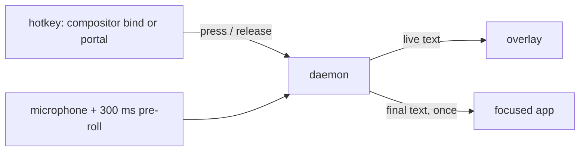

# earwig

Local dictation for Linux desktops. Hold a key and talk, or tap it to keep
listening. A small overlay shows what you are saying as you say it, and when
you stop, the whole text lands in the focused app at once.

- **Instant.** The default model streams: by the time you let go, almost
  everything is already transcribed, and the text is inserted in one step,
  never typed out character by character.
- **Local.** Speech never leaves the machine. Models run on the GPU (Vulkan)
  or CPU through [transcribe.cpp](https://github.com/handy-computer/transcribe.cpp).
- **Small.** One daemon, a settings window, a tray icon. Rust and
  [GPUI](https://www.gpui.rs/).

## How it works



- **Hold** the key longer than 300 ms: push-to-talk, it stops when you let go.
- **Tap** it: recording stays on until the next tap.
- **Cancel** discards the recording.

The microphone stays open between dictations (configurable) and keeps the
last 300 ms, so a word started just before the key went down is not lost.

## Desktop support

earwig never checks which desktop it runs on. At startup it asks the
compositor and the XDG portals what they offer and uses the best mechanism
available:

| Need | First choice | Fallback |
| --- | --- | --- |
| Hotkey press and release | compositor binding running `earwig press` / `earwig release` | GlobalShortcuts portal |
| Insert text | Wayland input method: the whole string in one commit, clipboard untouched | clipboard + one paste shortcut (Ctrl+Shift+V in terminals), then the RemoteDesktop portal |
| Overlay | wlr-layer-shell: floats, never takes focus, clicks pass through | X11 override-redirect window (XWayland) |

What that means in practice:

| Desktop | Hotkey | Insertion | Overlay |
| --- | --- | --- | --- |
| niri | press/release binds (niri after 26.04) | input method, else paste | layer-shell |
| sway, Hyprland, river | release binds | input method, else paste | layer-shell |
| COSMIC | custom shortcut running `earwig toggle` | input method, else paste | layer-shell |
| KDE Plasma 6 | GlobalShortcuts portal | RemoteDesktop portal (one-time consent) | layer-shell |
| GNOME 48+ | GlobalShortcuts portal | RemoteDesktop portal (one-time consent) | XWayland popup |

After a paste, the transcript stays on the clipboard. If insertion fails,
the text is put on the clipboard and kept in history.

With the RemoteDesktop portal, earwig recognizes a focused terminal by its
accessibility role. Qt apps such as Konsole report it only with
`QT_LINUX_ACCESSIBILITY_ALWAYS_ON=1` in the session environment; the NixOS
module sets it, elsewhere set it yourself or Konsole gets Ctrl+V.

## Install

### NixOS

```nix
{
  inputs.earwig.url = "github:adeci/earwig";

  outputs = { nixpkgs, earwig, ... }: {
    nixosConfigurations.my-machine = nixpkgs.lib.nixosSystem {
      modules = [
        earwig.nixosModules.default
        { services.earwig.enable = true; }
      ];
    };
  };
}
```

This installs `earwig` and a systemd user service for the graphical session.
The default model is fetched at build time, so dictation works offline from
the first login. Options:

- `services.earwig.models`: models fetched at build time and installed
  system-wide (default: the catalog default; more from
  `earwig.legacyPackages.${system}.models`). They show up as downloaded, and
  users can still switch or download others in the settings window.
- `services.earwig.settings`: any [configuration](#configuration) key. Keys
  set here are locked in the settings window.

### Other distributions

With Nix: `nix profile install github:adeci/earwig`, then start
`earwig daemon` with your session. Building from source needs Rust, CMake,
`glslc` (shaderc), Vulkan headers and loader, ALSA, Wayland, xkbcommon,
fontconfig and freetype; see `nix/package.nix`.

## Hotkeys

**niri** (press/release binds are in niri after 26.04):

```kdl
binds {
    Mod+Space {
        press { spawn "earwig" "press"; }
        release { spawn "earwig" "release"; }
    }
    Mod+Shift+Space { spawn "earwig" "cancel"; }
}
```

**sway**:

```
bindsym --no-repeat Mod4+space exec earwig press
bindsym --release Mod4+space exec earwig release
bindsym Mod4+Shift+space exec earwig cancel
```

**Hyprland**:

```
bind = SUPER, space, exec, earwig press
bindr = SUPER, space, exec, earwig release
bind = SUPER SHIFT, space, exec, earwig cancel
```

**GNOME, KDE**: earwig registers "Dictate" (default Super+Alt+Space; Super+Space
is GNOME's input-source switch) and "Cancel dictation" with the GlobalShortcuts
portal on first start. Confirm them in the dialog and change them later in the
system keyboard settings.

**COSMIC**: Settings → Keyboard → Keyboard Shortcuts → Custom Shortcuts →
Add Shortcut, command `earwig toggle`, key e.g. Super+Space. That is stored in
`~/.config/cosmic/com.system76.CosmicSettings.Shortcuts/v1/custom`:

```
{
    (modifiers: [Super], key: "space"): Spawn("earwig toggle"),
}
```

COSMIC runs a shortcut on key press only (modifier-only shortcuts on
release only), never on both, so hold-to-talk needs `earwig press`/`release`
from elsewhere; tap to start, tap to stop.

**Anything else**: bind a key to `earwig toggle` (tap to start, tap to stop).

## Models

The default is Parakeet Unified 0.6B (English, streaming). The settings
window offers a few curated alternatives and searches Hugging Face for any
model published for transcribe.cpp. Before you download anything, it reads
each file's header to check that the engine can load it.

```
earwig models list                     # curated and downloaded
earwig models search parakeet          # Hugging Face, with compatibility
earwig models download nemotron-3.5-asr-streaming-0.6b
earwig models use hf:owner/repo/file.gguf@<commit>
earwig models use /path/to/model.gguf
```

Downloads resume after interruption, are pinned to a commit, and are checked
against the Hub's SHA-256. Any GGUF that transcribe.cpp supports works:
name it by catalog id, `hf:owner/repo/file@commit`, or path.

Downloaded models live in `~/.local/share/earwig/models/<owner>/<repo>/<commit>/<file>`.
earwig also looks in `earwig/models` under every `$XDG_DATA_DIRS` entry
(read-only), which is where the NixOS module and distro packages put
pre-installed models.

## Configuration

`~/.config/earwig/config.toml`, written by the settings window, layered over
`/etc/xdg/earwig/config.toml` (system; its keys win and are locked). All keys
are optional:

```toml
[hotkey]
mode = "hold-or-toggle"     # or "hold", "toggle"
hold_threshold_ms = 300
portal = true               # use the GlobalShortcuts portal when offered
portal_trigger = "LOGO+ALT+space"

[audio]
device = "default"          # see `earwig devices`
keep_open = true            # no clipped first word; the mic indicator stays on
preroll_ms = 300

[model]
model = "parakeet-unified-en-0.6b"
backend = "auto"            # or "cpu", "gpu"
language = "en"             # hint for multilingual models

[insert]
method = "auto"             # or "input-method", "paste", "portal"
terminals = ["my-terminal"] # extra app ids that get Ctrl+Shift+V

[overlay]
enabled = true
position = "bottom"         # or "top"
max_lines = 3

[history]
enabled = true
limit = 50

[hooks]
filter = ["sed", "s/nix os/NixOS/g"]  # text in on stdin, replacement out
filter_timeout_ms = 2000
on_insert = ["notify-send", "earwig"] # runs after each insertion, text on stdin
```

## Extending

- **Hooks**: `filter` rewrites the final text before insertion (word
  replacements, punctuation rules, an LLM cleanup pass); `on_insert` sees
  every transcript (logging, notifications).
- **Events**: `earwig events` prints one JSON object per state change,
  partial transcript, level and insertion; the same stream is on the control
  socket (`$XDG_RUNTIME_DIR/earwig.sock`) for status bars and scripts.
  `earwig status` prints a snapshot.
- **Code**: the daemon depends only on three small traits in `earwig-core`:
  `EngineFactory`/`Model` (speech engine), `Inserter` (text output) and
  `HotkeySource`. A new engine, output method or key source is one
  implementation; see `AGENTS.md`.

## Privacy

Audio is processed in memory and never written to disk. Transcripts are
kept in `~/.local/share/earwig/history.jsonl` (last 50; `history.enabled =
false` turns this off). Logs never contain transcript text above `debug`.
The only network access is model search and download.

## Development

```
nix develop
cargo test --workspace
cargo run -p earwig -- transcribe tests/fixtures/quick-brown-fox.wav
nix flake check -L     # package, clippy, tests, NixOS VM tests (needs KVM)
```

The VM tests boot real desktops (niri, sway, GNOME, KDE, COSMIC) with a virtual
microphone playing the fixtures, press the hotkey, and check that the text
arrives in a focused editor or terminal.

## License

MIT. Models carry their own licenses (shown in the settings window); the
default Parakeet model is under the NVIDIA Open Model License.
